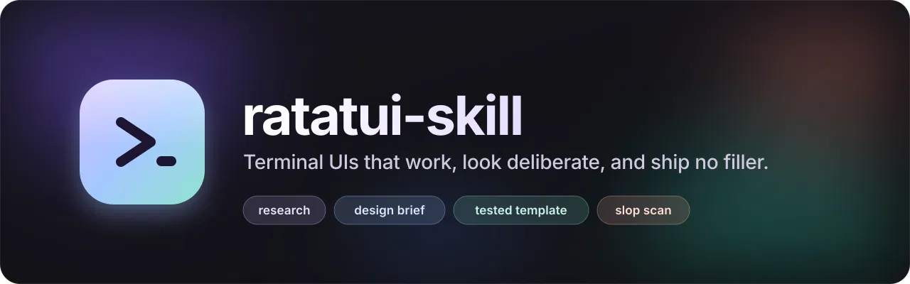
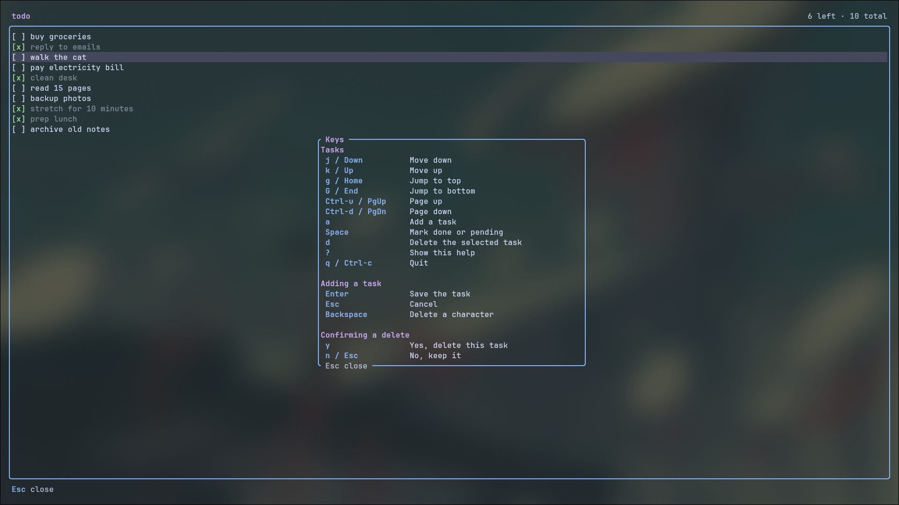
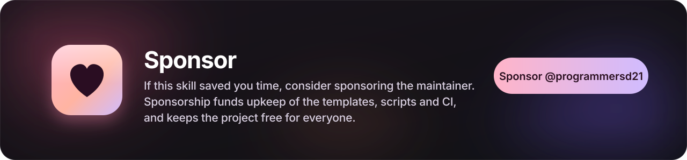

<p align="center">
  
</p>

<p align="center">
  <a href="https://github.com/programmersd21/ratatui-skill/actions/workflows/ci.yml"></a>
  
  
  
  
  <a href="https://github.com/sponsors/programmersd21"></a>
</p>

<h3 align="center">Make your AI assistant write Ratatui apps that actually work.</h3>

<p align="center">
  Current APIs. A deliberate design. Tested code. No filler.
</p>

<p align="center">
  <a href="#quick-start">Quick start</a> ·
  <a href="docs/agent-compatibility.md">Agent support</a> ·
  <a href="#what-changes">What changes</a> ·
  <a href="#how-it-works">How it works</a> ·
  <a href="#demo">Demo</a> ·
  <a href="#faq">FAQ</a> ·
  <a href="#sponsor">Sponsor</a>
</p>

---

<p align="center">
  
</p>

AI assistants write ratatui from memory. They reach for old APIs and wrong crate versions, then ship a UI that looks generated: neon defaults, decorative panels, keys that do nothing.

**ratatui-skill** provides a practical workflow, version-aware research, a working reference template, and verification guidance. The assistant inspects the project, adapts the process to the task, and reports what it actually checked.

## Quick start

1. Copy the canonical skill directory into a discovery location supported by your agent. From the root of this repository:

   **Codex, Cursor, Antigravity, and OpenCode:**

   ```bash
   mkdir -p /path/to/project/.agents/skills
   rm -rf /path/to/project/.agents/skills/ratatui
   cp -a skills/ratatui /path/to/project/.agents/skills/ratatui
   ```

   **Claude Code:**

   ```bash
   mkdir -p /path/to/project/.claude/skills
   rm -rf /path/to/project/.claude/skills/ratatui
   cp -a skills/ratatui /path/to/project/.claude/skills/ratatui
   ```

   See [agent compatibility and installation](docs/agent-compatibility.md) for global installs and native alternatives.

2. Ask for a terminal UI:

   ```text
   Use the ratatui skill. Build a simple TUI in Rust: a todo list. Add items,
   mark them done, delete them, and save to a file so they're still there next time.
   ```

3. Watch it inspect the project, choose a proportionate workflow, build, and run relevant checks.

`AGENTS.md` is a concise fallback for agents that read repository instructions but do not discover skills. It does not install or auto-register the skill. See [agent compatibility](docs/agent-compatibility.md) for the supported discovery paths.

## What changes

| Without the skill | With it |
|---|---|
| Versions and APIs written from memory | Resolved versions and project constraints checked; release notes reviewed when versions or recent APIs change |
| Design choices are implicit | Layout and interactions follow the requirements and displayed data; document decisions when complexity warrants it |
| Decorative panels, fake data, dead keys | Everything visible works |
| Structure chosen without considering scope | Clear state/rendering boundaries and shared key bindings where they reduce coupling or duplication |
| "Done" with nothing run | Relevant fmt, Clippy and tests; render or terminal integration checks where behavior requires them; honest reporting |
| Silent about what was skipped | A report that names anything it could not check |

## How it works

<details open>
<summary><b>Five steps, in order</b></summary>

1. **Research.** Check the newest stable and minimum supported versions alongside versions resolved by the project. Preserve existing constraints; review release notes when changing versions or relying on recently changed APIs. Confirm widget crates match the resolved Ratatui version and compile uncertain APIs.
2. **Design.** For a non-trivial new interface, make the interaction model, layout, keyboard behavior, and relevant empty/error states explicit before implementation. Keep this lightweight for small tasks.
3. **Build** with the simplest architecture that fits. Use the dirview template as a reference when its structure is relevant; preserve existing project conventions.
4. **Verify.** Run relevant formatting, Clippy and test checks. Use TestBackend for rendering behavior and PTY or recording-based tests when real terminal interaction matters. Report anything not checked.
5. **Report honestly,** including anything it could not check.

</details>

<details open>
<summary><b>The rules it enforces</b></summary>

- Everything visible works. No fake data, decorative panels or dead keys.
- When input, footer hints, and help repeat the same bindings, keep them in sync through a shared source of truth.
- Text is measured with `unicode-width`, untrusted text is sanitized, only visible rows are drawn.
- Choose colors and visual conventions for the product and terminal environment; support monochrome output when required.
- Handle errors deliberately and use compiler-visible Clippy lints where a project wants to prohibit specific patterns.
- Destructive actions confirm. Slow work never blocks the draw loop.

</details>

## Demo

The skill was used to build `todo/`, a persistent todo list. It is a header and list of tasks: `a` adds one, `Space` marks it done, `d` then `y` deletes it, and every change is written to a plain text file on disk. The screenshot shows the opt-in Catppuccin Mocha theme.

<p align="center">
  
</p>

```bash
cd todo
TODO_THEME=catppuccin cargo run --bin todo
```

The demo uses the terminal palette by default and supports `NO_COLOR` for monochrome output. Source, keys and the file format are in [`todo/README.md`](todo/README.md).

## What's inside

```text
AGENTS.md                      the process in short form, for agents without skill support
assets/                        banner, demo, faq and sponsor images
docs/                          version-aware distribution proposal
evals/                         task suite, paired-run harness, scoring rubric, human-review records
skills/ratatui/
  SKILL.md                     the process
  references/
    research-checklist.md      finding current versions and APIs; pitfalls found in practice
    ux-principles.md           layouts, keys, color, responsiveness
    slop-tells.md              what reads as generated, with before and after
  scripts/
    crate-versions.sh          newest stable version and MSRV via cargo info
    lint-slop.sh               mechanical slop scanner; exit status gates CI
    pty-smoke.py               run a TUI in a pseudo-terminal and check it behaves
  templates/dirview/           a complete ratatui 0.30 directory browser
todo/                          the demo todo app built with the skill
.github/                       issue and PR templates, sponsors, CI for both crates
```

### The template

`dirview` is a working program, not a sketch: list and preview panes, filtering, sorting, hidden files, a generated help overlay, empty and error states, a too-small message, `NO_COLOR`, and wide-character-safe layout. It has unit tests for state and keys, headless render tests, and passes clippy with warnings denied.

```bash
cd skills/ratatui/templates/dirview
cargo run -- .
```

## FAQ

<p align="center">
  
</p>

<p align="center">
  <a href="#compatibility"><b>Compatibility</b></a> ·
  <a href="#versions"><b>Versions</b></a> ·
  <a href="#slop-scan"><b>Slop scan</b></a> ·
  <a href="#ai-written"><b>AI-written?</b></a>
</p>

---

### Compatibility

<details>
<summary><b>Does it only work with Claude Code?</b></summary>
<br>

**No. The skill uses the open Agent Skills directory format.**

Codex, Claude Code, Cursor, Antigravity, and OpenCode document compatible
skill discovery paths. Use the install location listed in
[`docs/agent-compatibility.md`](docs/agent-compatibility.md). The repository
has not yet been runtime-smoke-tested in every listed client.

</details>

### Versions

<details>
<summary><b>Will it always pick the newest ratatui?</b></summary>
<br>

**It looks the version up every time instead of trusting the docs.**

The versions in this repo are what the template was tested with, ratatui 0.30.2
on its minimum supported Rust version, 1.88. They are not a promise about what is newest when you read this. The skill
tells the assistant to:

1. Run `crate-versions.sh` for relevant dependencies.
2. Preserve project constraints and inspect release notes when changing versions or using recently changed APIs.
3. Compile any API it is unsure about before using it.

</details>

### Slop scan

<details>
<summary><b>Why a "slop scan"?</b></summary>
<br>

**The scanner is deliberately narrow. It is a guardrail, not an AI-slop detector.**

It checks a small set of mechanical source conventions. It cannot reliably
judge visual hierarchy, fake data, unnecessary abstractions, or whether a design
fits the product. Those require behavior tests and human review. See
[`references/slop-tells.md`](skills/ratatui/references/slop-tells.md).

</details>

### AI-written?

<details>
<summary><b>Is the code AI-written?</b></summary>
<br>

**Yes, with AI assistance, and verified in CI.**

Every template file is compiled and tested, and the process is written down so
you can check the result yourself.

</details>

---

<p align="center">
  Still stuck? <a href="https://github.com/programmersd21/ratatui-skill/issues/new/choose">Open an issue</a> or <a href="https://github.com/programmersd21/ratatui-skill/discussions">ask in Discussions</a>.
</p>

## Provenance

The tells and principles come from public discussions of AI-generated projects and from lazygit's published design principles. `references/` marks where a rule is this project's own judgment. The template was built and tested with ratatui 0.30.2 at Rust 1.88. Versions in the docs are examples; the skill tells the assistant to look them up again.

## Contributing

Issues and pull requests are welcome. Good first contributions: a pitfall you hit with a ratatui release, a slop tell the scanner misses, or a second template (an async dashboard is the most requested gap). Run the checks before opening a PR:

```bash
cd skills/ratatui/templates/dirview && cargo fmt --check && cargo clippy --all-targets -- -D warnings && cargo test
cd todo && cargo fmt --check && cargo clippy --all-targets -- -D warnings && cargo test
python3 skills/ratatui/scripts/pty-smoke.py target/debug/<binary>
skills/ratatui/scripts/lint-slop.sh .
```

If this saved you time, a star helps other people find it.

## Sponsor

<p align="center">
  <a href="https://github.com/sponsors/programmersd21">
    
  </a>
</p>


## License

[MIT](LICENSE)
